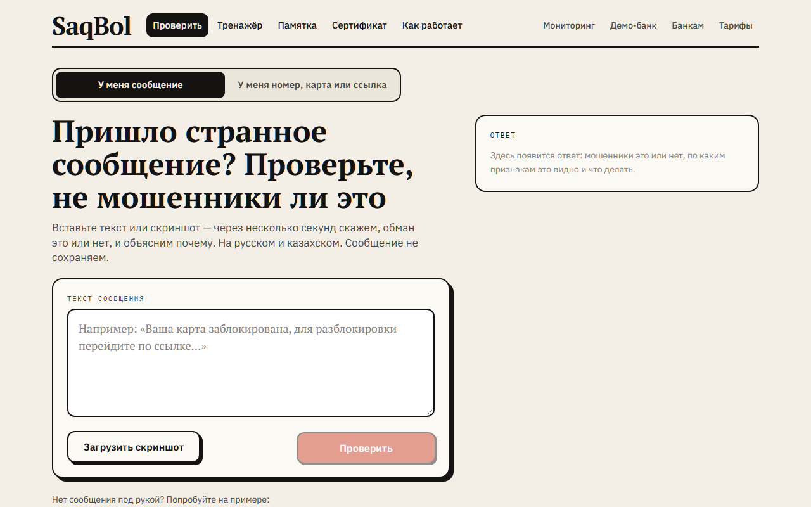
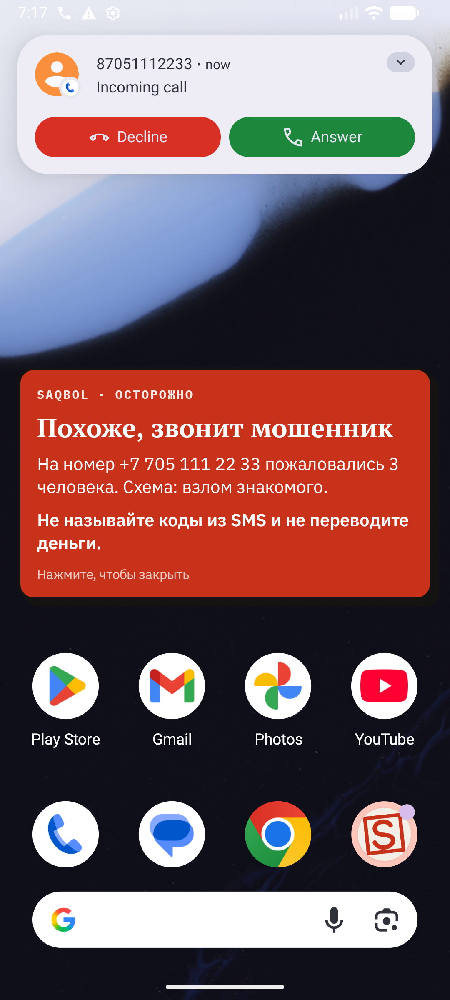
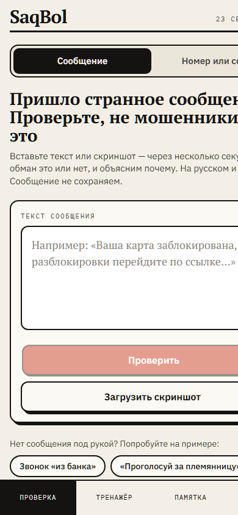
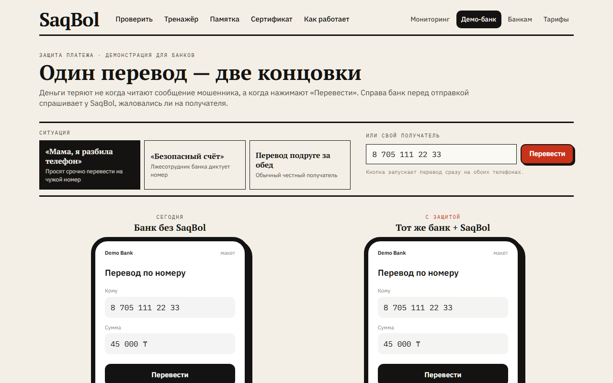
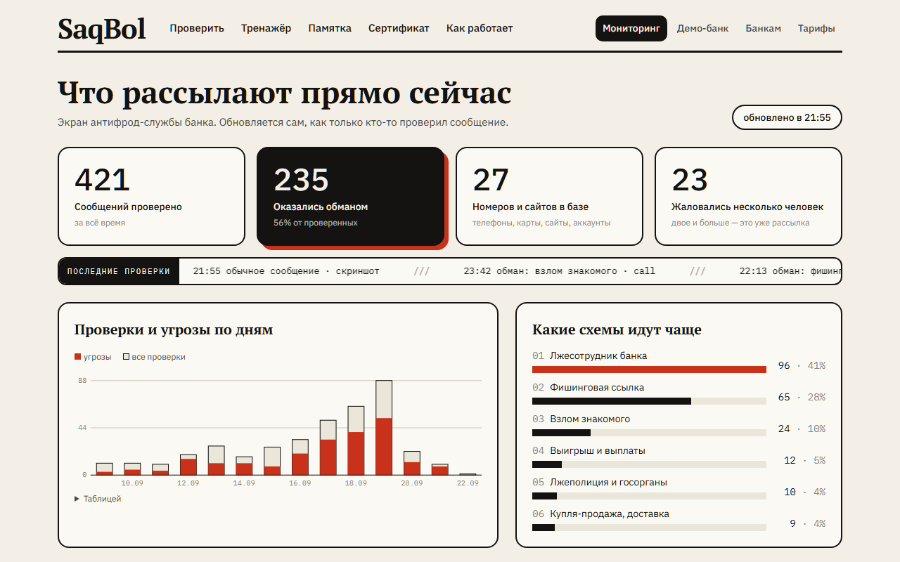

<p align="center">
  
</p>

<h1 align="center">SaqBol — be careful</h1>

<p align="center">
  <b>A crowd-powered scam detection network for Kazakhstan.</b><br>
  One person has a doubt, everyone gets warned.
</p>

<p align="center">
  <a href="https://saqbol-ai-kz.web.app"></a>
  <a href="https://t.me/saqbolai_bot"></a>
  
  
  
</p>

<p align="center">
  <a href="README.ru.md">Русская версия</a>
</p>

<p align="center">
  
</p>

A person forwards a suspicious message, screenshot, voice message or QR code and within seconds gets a plain-language answer: is it a scam, which scheme it is, which signs give it away and what to do. Phone numbers, cards, links and accounts from scam messages go into a **shared database**. The next person who receives the same number sees "N people have already reported it", and a bank can check a transfer recipient against the database **before the money leaves**.

## Why it matters

- **26.3 thousand** online fraud cases in Kazakhstan in January–November 2025, 3.4 times more than in 2019. Losses of **11.2 billion ₸**, **96.7%** of it from ordinary people ([Prosecutor General's Office of Kazakhstan](https://informburo.kz/novosti/rekordnoe-kolicestvo-skolko-slucaev-mosennicestva-v-seti-zaregistrirovali-v-kazaxstane-v-2025-godu)).
- A bank learns about a scammer **after** the transfer, and only if the victim reports it. Only **one in five** does.
- The National Bank's Anti-Fraud Center has blocked 2.8 billion ₸ over its whole lifetime ([National Bank of Kazakhstan](https://nationalbank.kz/ru/news/informacionnye-soobshcheniya/18571)). It sees the transaction when the transfer is already happening.

**SaqBol catches the signal earlier than anyone, at the moment a person is only starting to doubt.** It is not a competitor to the Anti-Fraud Center but an early sensor for it. All figures with sources are in [`docs/A6-cifry-kz.md`](docs/A6-cifry-kz.md) (in Russian).

## Three entry points into one network

| Telegram bot | Website | Android app |
|---|---|---|
| Check and report | Learn and show the bank | Protection at the moment of the call |
| Text, screenshots, **voice messages**, number lookup, trainer, "talk to a scammer" simulator, guide for parents | Message and recipient check, trainer, certificate, guide for parents, monitoring, **Demo bank**, pricing | **Warning over the incoming call screen**, **"Protect your family"**: a relative gets a Telegram message when a number from the database calls mom, "Who called?" after the call, "Share → SaqBol", **QR code scanner** |

<p align="center">
  
  &nbsp;&nbsp;
  
</p>

### One transfer, two endings

A bank mockup for the jury and anti-fraud teams: on the left the transfer goes to the scammer, on the right the same bank asks SaqBol and stops the payment.

<p align="center">
  
</p>

### What scammers are sending right now

An anti-fraud team screen: it updates itself after every check and shows the schemes of the week and the database with risk scoring.

<p align="center">
  
</p>

## How it works

```
 message · screenshot · voice · QR              call from an unknown number
              │                                            │
   ┌──────────▼──────────┐                      ┌──────────▼───────────┐
   │ 1. Rules            │  offline, instant    │ number checked       │
   │ 13 signs RU/KZ,     │                      │ against the database │
   │ 24 bank domains,    │                      │ → banner over the    │
   │ lookalike addresses │                      │   call screen        │
   └──────────┬──────────┘                      └──────────┬───────────┘
   ┌──────────▼──────────┐                      "It's a scam": one tap
   │ 2. Language model   │  meaning, not words             │
   │ verdict, scheme,    │                                 │
   │ signs, advice       │                                 │
   └──────────┬──────────┘                                 │
              ▼                                            ▼
        ┌─────────────────────────────────────────────────────────┐
        │  SHARED DATABASE: phones, cards, links, @accounts        │
        │  risk 1–99 by number of independent reporters and age    │
        └───────────────┬───────────────────────┬─────────────────┘
                        ▼                       ▼
              to the person: "already      to the bank: recipient
              reported by N people"        check before the transfer
```

- **Two layers.** Rules catch fake bank domains and typical phrasing, the model understands meaning. Safety net: a message with a fake bank address can never be marked "safe", whatever the model says. Without a model key everything still works on rules.
- **Explainable.** The person sees the signs in plain words, a bank analyst sees the risk formula: 1 reporter → 30, 2 → 50, 3 → 65, 10 → 97; a report's weight halves every 30 days.
- **Protection from abuse.** Reporters are counted by an anonymized code, a repeated report does not increase the counter, and one device can file at most 5 reports a day. A single report only produces a warning.
- **Data.** Message texts, screenshots and voice messages are not stored: the request is deleted right after the answer. Only aggregates and masked numbers leave the system. Database access rules are public: [`saqbol-site/firestore.rules`](saqbol-site/firestore.rules).

## Metrics

90 labeled messages in Russian and Kazakh: 45 scams, 45 normal ones, 30 of them deliberately tricky. Dataset: [`saqbol-bot/eval/dataset.jsonl`](saqbol-bot/eval/dataset.jsonl), to reproduce: `python eval/run_eval.py --llm`.

| Mode | Accuracy | Precision | Recall | F1 | Scams missed | Tricky cases |
|---|---|---|---|---|---|---|
| Rules only | 0.811 | 0.818 | 0.800 | 0.809 | 9 of 45 | 18 of 30 |
| Rules + model | **0.989** | 0.978 | **1.000** | **0.989** | **0 of 45** | 29 of 30 |

The only error is a false alarm on "can you lend me 5000". For protecting money, that is the right side to err on. Honest caveat: the set was written by the authors based on real schemes; the next step is testing on a partner bank's live traffic.

## Repository layout

```
saqbol-bot/      Python 3.14 · aiogram · Telegram bot and all server-side logic
  saqbol/rules.py         layer 1: rules, works offline
  saqbol/llm.py           layer 2: language model (Gemini, Claude as fallback)
  saqbol/analyzer.py      combines both layers into one verdict
  saqbol/indicators.py    phones, cards (Luhn), domains, @accounts
  saqbol/store.py         shared database in Firestore, risk scoring, summary
  saqbol/webqueue.py      request queue from the website and the app
  saqbol/simulator.py     "Talk to a scammer"
  saqbol/chat_features.py trainer, guide, number lookup in Telegram
  eval/                   dataset and metrics script
saqbol-site/     Next.js 16 · TypeScript · Tailwind, static export on Firebase Hosting
saqbol-android/  Kotlin · Jetpack Compose: caller ID, "Share", QR scanner
docs/            Kazakhstan figures with sources, application materials, screenshots, test QR codes
```

The website and the app have no separate backend: they put a request into a Firestore queue, the bot processes it and writes the answer under the same id. One check costs about 1 ₸; model spending over the whole development was under one cent.

## Running it

```
cd saqbol-bot
python -m venv .venv && .venv\Scripts\pip install -r requirements.txt
copy .env.example .env         # TELEGRAM_BOT_TOKEN and GEMINI_API_KEY
# firebase-key.json: Firebase service account key, put it next to bot.py
.venv\Scripts\python bot.py
```

```
cd saqbol-site && npm install && npm run dev            # http://localhost:3000
npx next build && npx firebase-tools deploy --only hosting
```

App: open `saqbol-android` in Android Studio or run `./gradlew assembleDebug` (JDK 21).

## Roadmap

| Stage | What |
|---|---|
| **Now: TRL 4** | Working prototype: bot, website, app, Demo bank, metrics on the test set |
| **3 months: TRL 5** | Pilot with one bank, 1,000 real users, Kazakh website interface |
| **6–12 months: TRL 6–7** | Integration with a bank's anti-fraud system, data exchange with the Anti-Fraud Center, early signal about a new scheme from a spike of similar messages |
